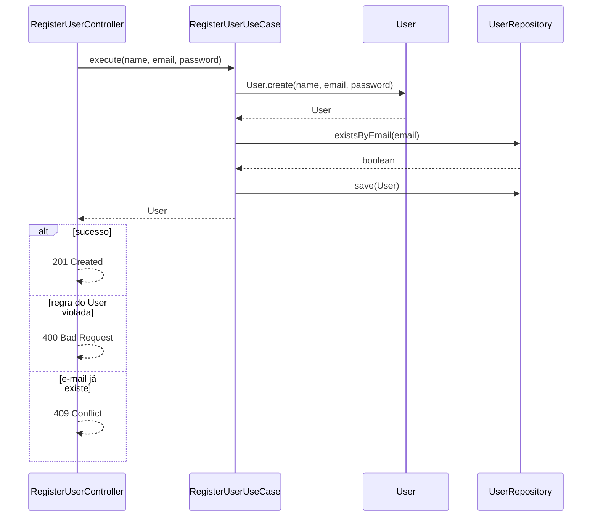
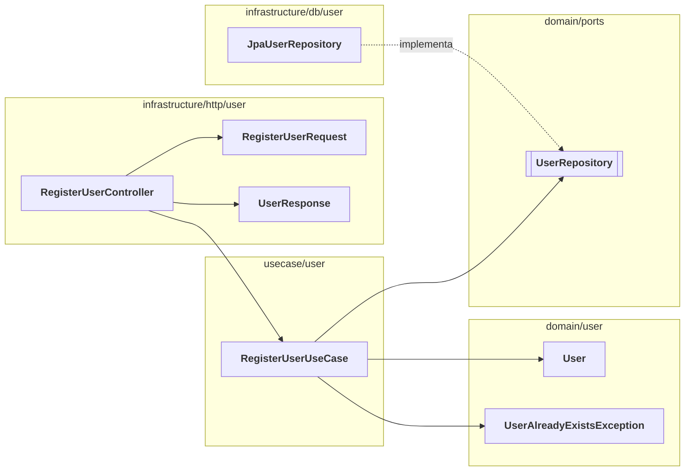

# NNN - Register User

<!--
Modelo de spec de operação. Copie para docs/<contexto>/NNN_<operação>.md e
troque o exemplo (registrar usuário) pela sua operação. Prefira diagramas e
tabelas a parágrafos: cada seção responde uma pergunta em poucos segundos.
-->

| Status | Origem | Contexto |
| --- | --- | --- |
| Rascunho | <de onde veio a necessidade>, AAAA-MM-DD | [User](000_user_context.md) |

<!-- Status: Rascunho → Aprovado → Concluído (ou Descartado). -->

Registra um usuário novo com nome, e-mail e senha.

## Problema

Hoje não há como uma pessoa criar a própria conta: o acesso depende de alguém cadastrá-la manualmente.

## Objetivos e fora do escopo

| Objetivos | Fora do escopo |
| --- | --- |
| Criar um usuário com e-mail único | Confirmação de e-mail |
| Guardar a senha apenas como hash | Login e emissão de token |

## Fluxo

## Estrutura

<!-- Os arquivos por camada. Em negrito o que esta operação cria; seta pontilhada = implementa a interface. -->

## Mudanças no que já existe

<!-- Uma linha por membro já existente que a operação altera, cria ou remove. Remova a seção na primeira operação do contexto. -->

| Onde | Membro | Mudança |
| --- | --- | --- |
| `UserRepository` | `existsByEmail(email)` | Novo: unicidade do e-mail |
| `UserEntity` | `toDomain()` | Novo: reconstrói o `User` vindo do banco |

## Domínio

### User

| Campo | Tipo | Regras |
| --- | --- | --- |
| `id` | UUID | Gerado pelo `User` |
| `name` | texto | Não vazio, máximo 100 caracteres |
| `email` | texto | E-mail válido, único, guardado em minúsculas |
| `passwordHash` | texto | Hash da senha; a senha em texto nunca é guardada |

## Erros

| Situação | Exceção | Resposta |
| --- | --- | --- |
| Campo inválido | `IllegalArgumentException` | 400 Bad Request |
| E-mail já cadastrado | `UserAlreadyExistsException` | 409 Conflict |

## Contrato

`POST /api/v1/users` → `201 Created`, com o `Location` do usuário criado.

| Request | Tipo | Obrigatório | Response | Tipo |
| --- | --- | --- | --- | --- |
| `name` | texto | sim | `id` | UUID |
| `email` | texto | sim | `name` | texto |
| `password` | texto | sim | `email` | texto |

## Decisões

<!-- Uma linha por escolha não óbvia; o conteúdo fica na decisão, não aqui. -->

| Decisão | Por quê, em uma frase |
| --- | --- |
| [0001 - Senhas com bcrypt](../decisions/0001-senhas-com-bcrypt.md) | Padrão do framework, custo ajustável |

## Resultado

<!-- Preenchido quando a operação é concluída: o PR e o que mudou em relação ao planejado. -->

| PR | Diferenças do planejado |
| --- | --- |
| #<número> | Nenhuma |
