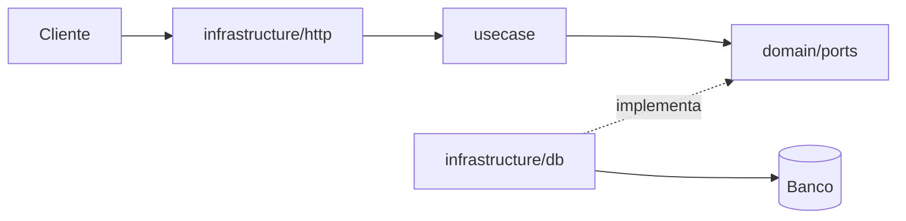

# Arquitetura

<!-- Visão geral do projeto. Muda pouco: ao adicionar uma dependência ou mudar a estrutura. Os fluxos de cada operação ficam nas specs. -->

<Uma frase: o que o sistema é e como se conecta com o mundo.>

## Stack

| Tecnologia | Versão | Para quê |
| --- | --- | --- |
| <Linguagem> | <versão> | Linguagem |
| <Framework> | <versão> | <ex.: API HTTP> |

## Dependências

<!-- Uma linha por dependência adicionada além da stack, com a decisão que a aprovou quando houver. -->

| Dependência | Versão | Para quê | Decisão |
| --- | --- | --- | --- |

## Camadas

<!-- Igual às regras do teste de arquitetura. -->

| Pacote | Papel | Pode depender de |
| --- | --- | --- |
| `domain` | Tipos e regras do núcleo, sem I/O | `domain` |
| `domain/ports` | Só interfaces: o que o núcleo precisa de fora | `domain` |
| `usecase` | Lógica de aplicação que orquestra as portas | `domain` |
| `infrastructure` | Adaptadores que implementam as portas (banco, HTTP, mensageria) | `domain`, `infrastructure` |
| `application` | Composição: cria os adaptadores e os conecta | tudo |

Regra de dependência: `domain` ← `usecase` ← `infrastructure` ← `application`.
